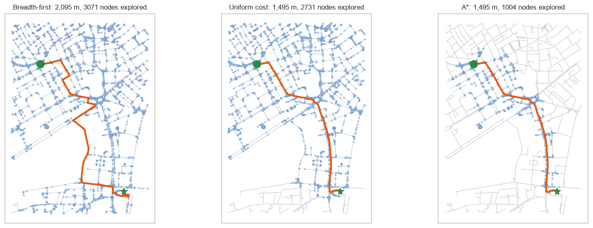

<div align="center">

<h1>Pathfinding lab</h1>

<p>Breadth-first, depth-first, uniform cost, greedy best-first and A* search, compared on four problems: random mazes, the 8-puzzle, a robot on an obstacle grid and walking routes on a real street map of Westminster, London. One search engine solves all four, and an interactive demo runs every search live.</p>

<p>
<a href="https://github.com/pxnz3r/pathfinding-lab/actions/workflows/ci.yml"></a>

<a href="LICENSE"></a>
</p>

<p><a href="docs/results.md">Results</a> · <a href="docs/methodology.md">Methodology</a> · <a href="docs/deploy.md">Deploy the demo</a></p>



</div>

## How it works

1. **Generate** random mazes, 8-puzzle scrambles and robot grids, and load a real street map of Westminster.
2. **Run** breadth-first, depth-first, uniform cost, greedy best-first and A* on the same instances.
3. **Measure** path length, cost, states explored, frontier size and time.
4. **Test the differences** with paired sign tests and compare heuristics by effective branching factor.
5. **Run every search yourself** in the Streamlit demo, from mazes to real Westminster streets.

## Results

| Problem | Brief | Finding |
| --- | --- | --- |
| Maze | BFS vs DFS: paths, time, explored nodes | Similar exploration, but DFS paths are 1.4 to 3.1 times longer, worse in bigger mazes |
| 8-puzzle | A* with Manhattan distance | 20 moves from solved: BFS explores ~48,000 boards, A* (misplaced tiles) ~3,400, A* (Manhattan) ~250 |
| Robot | greedy best-first vs A* | Greedy explores half as many cells but its path was longer on every grid: +8% with 10% obstacles, +27% with 30% |
| City map | BFS, UCS, A* | A* matches UCS's shortest walks exploring 3.4 times fewer points; BFS routes are 15% longer |

**Maze** (10 random mazes per size, averages):

| Size | BFS steps | DFS steps | BFS explored | DFS explored |
| --- | --- | --- | --- | --- |
| 15x15 | 34.6 | 49.2 | 75 | 82 |
| 25x25 | 62.0 | 109.8 | 225 | 232 |
| 35x35 | 87.8 | 217.0 | 535 | 497 |
| 45x45 | 117.6 | 370.0 | 961 | 779 |

**City map** (all 45 routes between ten landmarks, averages):

| Algorithm | Metres | Over shortest | Points explored |
| --- | --- | --- | --- |
| Breadth-first | 1,075 | +142 | 1,781 |
| Uniform cost | 933 | 0 | 1,792 |
| A* (straight-line estimate) | 933 | 0 | 533 |

Full tables and figures: [docs/results.md](docs/results.md). How it was done: [docs/methodology.md](docs/methodology.md).

## How sure the results are

**Every comparison is a real difference.** Each pair of algorithms ran on the same instances, and the sign test rejects chance for all eight comparisons (p < 0.05).

**Breadth-first always finds the shortest maze path** (40 of 40 mazes) and explores less than depth-first on 12 mazes, more on 27.

**Greedy best-first is fast but loses.** It explores less than A* on all 46 robot grids and finds a longer path on all 46.

**Manhattan distance is the better heuristic.** A* explores fewer boards with it on all 61 8-puzzle boards that differ. Its effective branching factor stays around 1.1 to 1.3, against 1.2 to 1.4 for misplaced tiles and 1.5 to 1.8 for breadth-first.

Every table and figure behind these is in [docs/results.md](docs/results.md).

## Run it

Needs Python 3.14+ and [uv](https://docs.astral.sh/uv/).

```bash
uv sync
uv run python main.py
uv run streamlit run app.py
```

`main.py` runs every comparison and writes figures and tables to `outputs/` and `docs/results.md`. The demo runs searches live and needs nothing from `main.py` except the Results tab.

## The demo

- **Overview**: the algorithms and what was found.
- **Maze**: generate a maze and watch breadth-first and depth-first side by side.
- **8-puzzle**: scramble a board, solve it with A* (pick the heuristic) and breadth-first, and step through the solution.
- **Robot**: set the obstacle density and compare greedy best-first with A*.
- **City map**: pick two Westminster landmarks and compare breadth-first, uniform cost and A* on the real streets.
- **Results**: the benchmark tables and figures.

## Layout

```
pathfinding_lab/   grids.py (maze and robot), puzzle.py (8-puzzle), city.py (street map), report.py
pxlab/             shared engine (vendored): search algorithms, app helpers
maps/              westminster.json, the street graph
scripts/           build_city_map.py, rebuilds the street graph from OpenStreetMap
main.py            every comparison
app.py             the Streamlit demo
docs/              methodology, results, deploy
```

## Data

Street map: © [OpenStreetMap](https://www.openstreetmap.org/copyright) contributors, available under the Open Database License. `maps/westminster.json` is derived from it and is under the same license. Mazes, grids and puzzles are generated from fixed seeds.

## License

Code: MIT. `maps/westminster.json`: ODbL 1.0.
