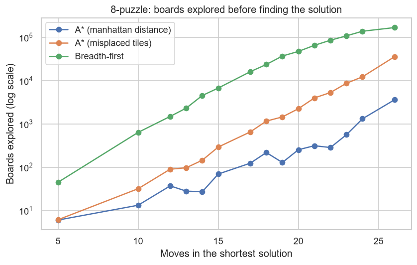
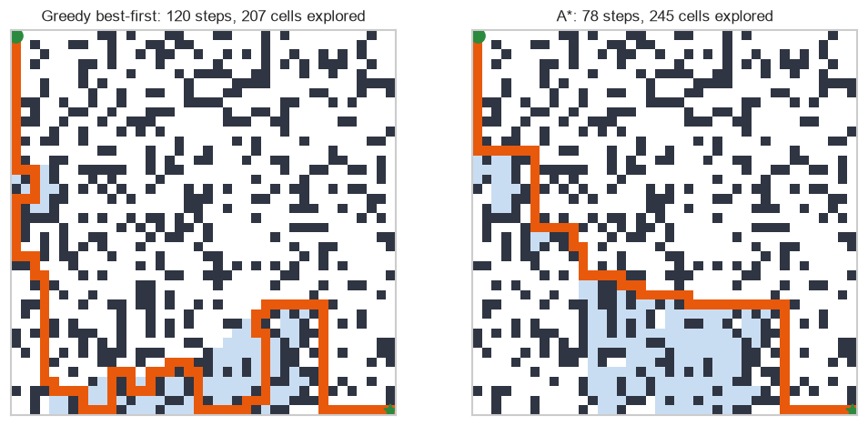

# Results

Produced by `python main.py`. Times are from one laptop run in plain Python and only comparable with each other; the counts of explored states don't depend on the machine.

## Maze

Breadth-first against depth-first, averaged over 10 random mazes per size.

### Maze benchmark

| Size | Algorithm | Path steps | Explored | Largest frontier | Milliseconds |
| --- | --- | --- | --- | --- | --- |
| 15x15 | Breadth-first | 34.6 | 75.0 | 5.8 | 0.17 |
| 15x15 | Depth-first | 49.2 | 82.1 | 8.8 | 0.21 |
| 25x25 | Breadth-first | 62.0 | 225.3 | 10.2 | 0.76 |
| 25x25 | Depth-first | 109.8 | 232.3 | 23.0 | 0.91 |
| 35x35 | Breadth-first | 87.8 | 534.6 | 15.5 | 1.98 |
| 35x35 | Depth-first | 217.0 | 496.6 | 44.3 | 2.02 |
| 45x45 | Breadth-first | 117.6 | 961.4 | 21.1 | 3.11 |
| 45x45 | Depth-first | 370.0 | 778.8 | 64.6 | 2.65 |

## 8-puzzle

A* with two heuristics against breadth-first, averaged over the scrambled boards whose shortest solution has the same number of moves.

### 8-puzzle benchmark

| Optimal moves | Algorithm | Explored | Largest frontier | Milliseconds | Boards |
| --- | --- | --- | --- | --- | --- |
| 5 | A* (manhattan distance) | 6.0 | 6.8 | 0.1 | 10 |
| 5 | A* (misplaced tiles) | 6.1 | 6.8 | 0.1 | 10 |
| 5 | Breadth-first | 44.8 | 35.4 | 0.2 | 10 |
| 10 | A* (manhattan distance) | 13.2 | 12.1 | 0.1 | 10 |
| 10 | A* (misplaced tiles) | 31.8 | 25.2 | 0.2 | 10 |
| 10 | Breadth-first | 637.9 | 384.9 | 2.0 | 10 |
| 12 | A* (manhattan distance) | 37.0 | 27.0 | 0.3 | 1 |
| 12 | A* (misplaced tiles) | 90.0 | 65.0 | 0.6 | 1 |
| 12 | Breadth-first | 1494.0 | 903.0 | 3.8 | 1 |
| 13 | A* (manhattan distance) | 28.0 | 22.0 | 0.2 | 1 |
| 13 | A* (misplaced tiles) | 97.0 | 67.0 | 0.6 | 1 |
| 13 | Breadth-first | 2322.0 | 1457.0 | 8.3 | 1 |
| 14 | A* (manhattan distance) | 27.0 | 22.0 | 0.2 | 1 |
| 14 | A* (misplaced tiles) | 145.0 | 98.0 | 0.9 | 1 |
| 14 | Breadth-first | 4535.0 | 2437.0 | 18.8 | 1 |
| 15 | A* (manhattan distance) | 69.5 | 49.0 | 0.7 | 10 |
| 15 | A* (misplaced tiles) | 292.4 | 196.0 | 2.5 | 10 |
| 15 | Breadth-first | 6766.0 | 3748.7 | 26.7 | 10 |
| 17 | A* (manhattan distance) | 124.0 | 87.0 | 2.5 | 1 |
| 17 | A* (misplaced tiles) | 655.0 | 420.0 | 10.6 | 1 |
| 17 | Breadth-first | 16163.0 | 8109.0 | 61.7 | 1 |
| 18 | A* (manhattan distance) | 218.3 | 137.7 | 1.8 | 6 |
| 18 | A* (misplaced tiles) | 1164.2 | 725.7 | 10.5 | 6 |
| 18 | Breadth-first | 23730.8 | 10774.0 | 86.6 | 6 |
| 19 | A* (manhattan distance) | 128.3 | 84.3 | 2.1 | 3 |
| 19 | A* (misplaced tiles) | 1453.3 | 907.3 | 20.6 | 3 |
| 19 | Breadth-first | 37163.0 | 14600.3 | 196.9 | 3 |
| 20 | A* (manhattan distance) | 253.8 | 159.0 | 3.0 | 13 |
| 20 | A* (misplaced tiles) | 2253.5 | 1375.2 | 19.1 | 13 |
| 20 | Breadth-first | 47567.9 | 17577.1 | 190.4 | 13 |
| 21 | A* (manhattan distance) | 313.8 | 195.0 | 3.2 | 4 |
| 21 | A* (misplaced tiles) | 3998.2 | 2364.0 | 49.6 | 4 |
| 21 | Breadth-first | 65708.5 | 21824.2 | 345.0 | 4 |
| 22 | A* (manhattan distance) | 284.8 | 178.5 | 2.4 | 6 |
| 22 | A* (misplaced tiles) | 5323.3 | 3084.3 | 49.6 | 6 |
| 22 | Breadth-first | 86268.2 | 24313.2 | 355.9 | 6 |
| 23 | A* (manhattan distance) | 564.0 | 333.0 | 4.0 | 1 |
| 23 | A* (misplaced tiles) | 8736.0 | 4870.0 | 98.5 | 1 |
| 23 | Breadth-first | 109020.0 | 25133.0 | 401.4 | 1 |
| 24 | A* (manhattan distance) | 1317.0 | 754.0 | 9.5 | 1 |
| 24 | A* (misplaced tiles) | 12300.0 | 6567.0 | 111.7 | 1 |
| 24 | Breadth-first | 139226.0 | 24053.0 | 529.7 | 1 |
| 26 | A* (manhattan distance) | 3624.0 | 1945.0 | 35.2 | 2 |
| 26 | A* (misplaced tiles) | 35888.5 | 14830.0 | 377.3 | 2 |
| 26 | Breadth-first | 169102.5 | 24518.0 | 632.5 | 2 |

## Robot

Greedy best-first against A* on 40x40 grids, 20 per obstacle density (grids where obstacles cut off the goal are skipped).

### Robot benchmark

| Density | Algorithm | Path steps | Explored | Milliseconds | Grids | Grids with a longer path |
| --- | --- | --- | --- | --- | --- | --- |
| 0.1 | A* | 78.0 | 158.42 | 0.93 | 19 | 0 |
| 0.1 | Greedy best-first | 83.89 | 86.42 | 0.45 | 19 | 19 |
| 0.2 | A* | 78.35 | 199.65 | 1.24 | 17 | 0 |
| 0.2 | Greedy best-first | 91.53 | 106.65 | 0.58 | 17 | 17 |
| 0.3 | A* | 79.8 | 314.1 | 2.03 | 10 | 0 |
| 0.3 | Greedy best-first | 101.2 | 163.7 | 0.95 | 10 | 10 |

## City map

Every route between ten Westminster landmarks (45 routes), walking distance in metres.

### City map benchmark

| Algorithm | Metres | Metres over shortest | Street segments | Explored | Milliseconds | Routes |
| --- | --- | --- | --- | --- | --- | --- |
| Breadth-first | 1074.8 | 141.5 | 75.0 | 1780.8 | 2.3 | 45 |
| Uniform cost | 933.3 | 0.0 | 83.5 | 1791.9 | 3.5 | 45 |
| A* | 933.3 | 0.0 | 83.5 | 533.3 | 2.8 | 45 |

