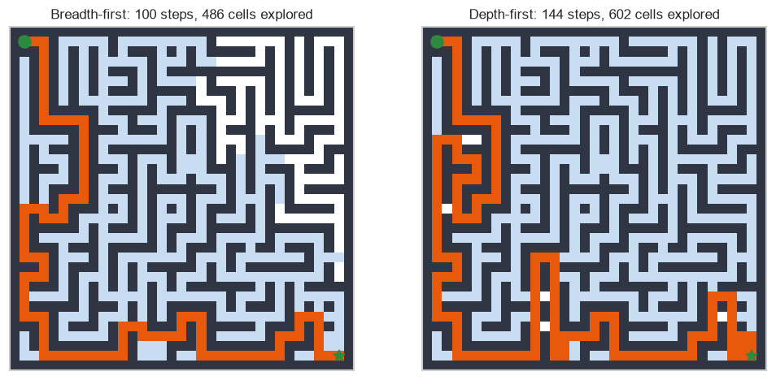
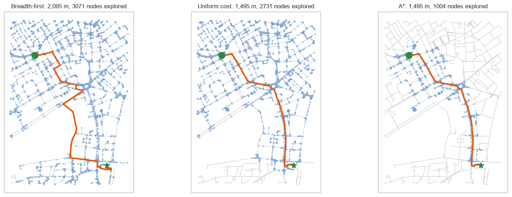

# Results

Produced by `python main.py`. Times are from one laptop run in plain Python and only comparable with each other; the counts of explored states don't depend on the machine.

## Maze

Breadth-first against depth-first, averaged over 10 random mazes per size.

### Maze benchmark

| Size | Algorithm | Path steps | Explored | Largest frontier | Milliseconds |
| --- | --- | --- | --- | --- | --- |
| 15x15 | Breadth-first | 34.6 | 75.0 | 5.8 | 0.17 |
| 15x15 | Depth-first | 49.2 | 82.1 | 8.8 | 0.2 |
| 25x25 | Breadth-first | 62.0 | 225.3 | 10.2 | 0.52 |
| 25x25 | Depth-first | 109.8 | 232.3 | 23.0 | 0.63 |
| 35x35 | Breadth-first | 87.8 | 534.6 | 15.5 | 2.0 |
| 35x35 | Depth-first | 217.0 | 496.6 | 44.3 | 2.0 |
| 45x45 | Breadth-first | 117.6 | 961.4 | 21.1 | 3.06 |
| 45x45 | Depth-first | 370.0 | 778.8 | 64.6 | 2.72 |

## 8-puzzle

A* with two heuristics against breadth-first, averaged over the scrambled boards whose shortest solution has the same number of moves.

### 8-puzzle benchmark

| Optimal moves | Algorithm | Explored | Largest frontier | Milliseconds | Boards |
| --- | --- | --- | --- | --- | --- |
| 5 | A* (manhattan distance) | 6.0 | 6.8 | 0.1 | 10 |
| 5 | A* (misplaced tiles) | 6.1 | 6.8 | 0.1 | 10 |
| 5 | Breadth-first | 44.8 | 35.4 | 0.2 | 10 |
| 10 | A* (manhattan distance) | 13.2 | 12.1 | 0.4 | 10 |
| 10 | A* (misplaced tiles) | 31.8 | 25.2 | 1.2 | 10 |
| 10 | Breadth-first | 637.9 | 384.9 | 6.8 | 10 |
| 12 | A* (manhattan distance) | 37.0 | 27.0 | 0.6 | 1 |
| 12 | A* (misplaced tiles) | 90.0 | 65.0 | 1.1 | 1 |
| 12 | Breadth-first | 1494.0 | 903.0 | 7.6 | 1 |
| 13 | A* (manhattan distance) | 28.0 | 22.0 | 0.4 | 1 |
| 13 | A* (misplaced tiles) | 97.0 | 67.0 | 1.4 | 1 |
| 13 | Breadth-first | 2322.0 | 1457.0 | 14.1 | 1 |
| 14 | A* (manhattan distance) | 27.0 | 22.0 | 0.4 | 1 |
| 14 | A* (misplaced tiles) | 145.0 | 98.0 | 1.7 | 1 |
| 14 | Breadth-first | 4535.0 | 2437.0 | 25.2 | 1 |
| 15 | A* (manhattan distance) | 69.5 | 49.0 | 3.0 | 10 |
| 15 | A* (misplaced tiles) | 292.4 | 196.0 | 4.8 | 10 |
| 15 | Breadth-first | 6766.0 | 3748.7 | 47.9 | 10 |
| 17 | A* (manhattan distance) | 124.0 | 87.0 | 1.9 | 1 |
| 17 | A* (misplaced tiles) | 655.0 | 420.0 | 7.9 | 1 |
| 17 | Breadth-first | 16163.0 | 8109.0 | 102.5 | 1 |
| 18 | A* (manhattan distance) | 218.3 | 137.7 | 4.7 | 6 |
| 18 | A* (misplaced tiles) | 1164.2 | 725.7 | 19.3 | 6 |
| 18 | Breadth-first | 23730.8 | 10774.0 | 186.8 | 6 |
| 19 | A* (manhattan distance) | 128.3 | 84.3 | 8.0 | 3 |
| 19 | A* (misplaced tiles) | 1453.3 | 907.3 | 19.3 | 3 |
| 19 | Breadth-first | 37163.0 | 14600.3 | 274.9 | 3 |
| 20 | A* (manhattan distance) | 253.8 | 159.0 | 3.9 | 13 |
| 20 | A* (misplaced tiles) | 2253.5 | 1375.2 | 40.3 | 13 |
| 20 | Breadth-first | 47567.9 | 17577.1 | 349.3 | 13 |
| 21 | A* (manhattan distance) | 313.8 | 195.0 | 5.6 | 4 |
| 21 | A* (misplaced tiles) | 3998.2 | 2364.0 | 63.7 | 4 |
| 21 | Breadth-first | 65708.5 | 21824.2 | 497.6 | 4 |
| 22 | A* (manhattan distance) | 284.8 | 178.5 | 4.9 | 6 |
| 22 | A* (misplaced tiles) | 5323.3 | 3084.3 | 104.1 | 6 |
| 22 | Breadth-first | 86268.2 | 24313.2 | 683.1 | 6 |
| 23 | A* (manhattan distance) | 564.0 | 333.0 | 21.2 | 1 |
| 23 | A* (misplaced tiles) | 8736.0 | 4870.0 | 234.9 | 1 |
| 23 | Breadth-first | 109020.0 | 25133.0 | 842.2 | 1 |
| 24 | A* (manhattan distance) | 1317.0 | 754.0 | 22.9 | 1 |
| 24 | A* (misplaced tiles) | 12300.0 | 6567.0 | 290.7 | 1 |
| 24 | Breadth-first | 139226.0 | 24053.0 | 1155.3 | 1 |
| 26 | A* (manhattan distance) | 3624.0 | 1945.0 | 87.2 | 2 |
| 26 | A* (misplaced tiles) | 35888.5 | 14830.0 | 784.2 | 2 |
| 26 | Breadth-first | 169102.5 | 24518.0 | 1253.4 | 2 |

## Robot

Greedy best-first against A* on 40x40 grids, 20 per obstacle density (grids where obstacles cut off the goal are skipped).

### Robot benchmark

| Density | Algorithm | Path steps | Explored | Milliseconds | Grids | Grids with a longer path |
| --- | --- | --- | --- | --- | --- | --- |
| 0.1 | A* | 78.0 | 158.42 | 1.78 | 19 | 0 |
| 0.1 | Greedy best-first | 83.89 | 86.42 | 0.82 | 19 | 19 |
| 0.2 | A* | 78.35 | 199.65 | 2.27 | 17 | 0 |
| 0.2 | Greedy best-first | 91.53 | 106.65 | 1.14 | 17 | 17 |
| 0.3 | A* | 79.8 | 314.1 | 3.28 | 10 | 0 |
| 0.3 | Greedy best-first | 101.2 | 163.7 | 1.56 | 10 | 10 |

## City map

Every route between ten Westminster landmarks (45 routes), walking distance in metres.

### City map benchmark

| Algorithm | Metres | Metres over shortest | Street segments | Explored | Milliseconds | Routes |
| --- | --- | --- | --- | --- | --- | --- |
| Breadth-first | 1074.8 | 141.5 | 75.0 | 1780.8 | 2.6 | 45 |
| Uniform cost | 933.3 | 0.0 | 83.5 | 1791.9 | 4.9 | 45 |
| A* | 933.3 | 0.0 | 83.5 | 533.3 | 3.3 | 45 |

## Statistics

Each pair of algorithms ran on the same instances, so every instance is a paired comparison. The sign test gives the chance of one side winning that many pairs if neither were really better. The effective branching factor b* is the branching of an even tree of the solution's depth holding as many nodes as the search explored: closer to 1 means a better-informed search.

### Paired comparisons (smaller is better)

| Study | Compared | On | Instances | Median, first | Median, second | First is smaller on | Second is smaller on | p-value (sign test) | Verdict |
| --- | --- | --- | --- | --- | --- | --- | --- | --- | --- |
| Maze | Breadth-first vs Depth-first | Explored | 40 | 362.5 | 351.5 | 12 | 27 | 0.023703 | real difference |
| Maze | Breadth-first vs Depth-first | Path steps | 40 | 77.0 | 148.0 | 40 | 0 | 0.0 | real difference |
| 8-puzzle | A* (manhattan distance) vs A* (misplaced tiles) | Explored | 70 | 99.5 | 912.0 | 61 | 0 | 0.0 | real difference |
| 8-puzzle | A* (misplaced tiles) vs Breadth-first | Explored | 70 | 912.0 | 20325.0 | 70 | 0 | 0.0 | real difference |
| Robot | Greedy best-first vs A* | Explored | 46 | 94.5 | 191.0 | 46 | 0 | 0.0 | real difference |
| Robot | A* vs Greedy best-first | Path steps | 46 | 78.0 | 88.0 | 46 | 0 | 0.0 | real difference |
| City map | A* vs Uniform cost | Explored | 45 | 363.0 | 1755.0 | 45 | 0 | 0.0 | real difference |
| City map | Uniform cost vs Breadth-first | Metres | 45 | 818.8000000000002 | 935.4999999999999 | 39 | 0 | 0.0 | real difference |

### 8-puzzle: effective branching factor by solution depth

| Optimal moves | A* (manhattan distance) | A* (misplaced tiles) | Breadth-first |
| --- | --- | --- | --- |
| 5 | 1.061 | 1.067 | 1.841 |
| 10 | 1.042 | 1.191 | 1.749 |
| 12 | 1.165 | 1.29 | 1.709 |
| 13 | 1.105 | 1.265 | 1.695 |
| 14 | 1.084 | 1.284 | 1.714 |
| 15 | 1.155 | 1.33 | 1.696 |
| 17 | 1.198 | 1.354 | 1.676 |
| 18 | 1.224 | 1.376 | 1.662 |
| 19 | 1.157 | 1.369 | 1.657 |
| 20 | 1.192 | 1.378 | 1.634 |
| 21 | 1.196 | 1.398 | 1.62 |
| 22 | 1.183 | 1.394 | 1.603 |
| 23 | 1.224 | 1.406 | 1.586 |
| 24 | 1.264 | 1.406 | 1.57 |
| 26 | 1.282 | 1.427 | 1.525 |
